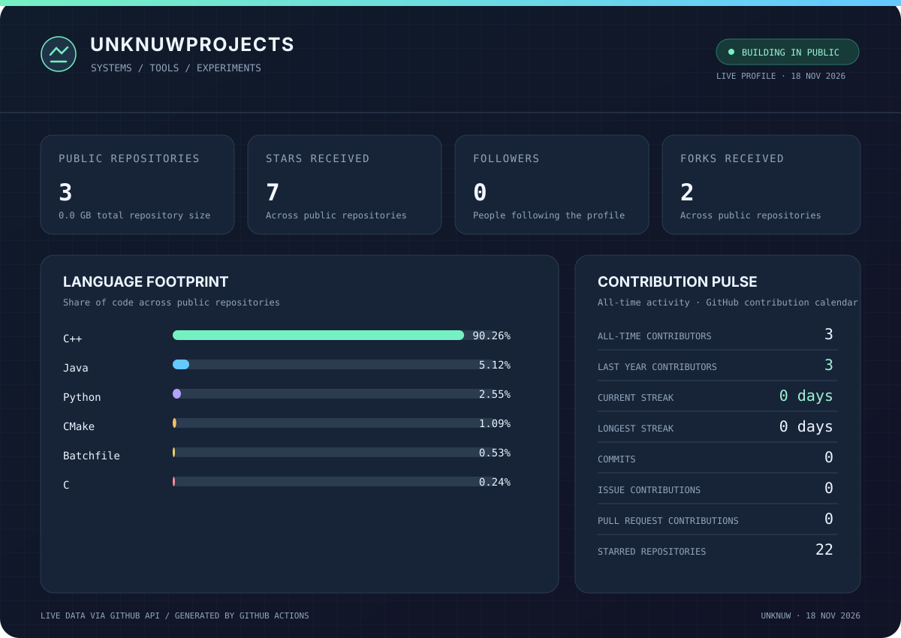

<div align="center">


# UNKNUWPROJECTS

**Full Nganggur Developer™**  
*Serious projects. Questionable sleep schedule.*

`ANDROID` · `LINUX` · `MAGISK` · `KERNELSU` · `GAME PORTS`

<p><sub>Building useful things. Breaking things occasionally. Learning either way.</sub></p>

</div>

---

## `$ whoami`

```bash
user@unknuw:~$ whoami
Full Nganggur Developer — yes, it's a real title.
No, HR hasn't called.

user@unknuw:~$ current_focus
Porting Xbox classics to Android.
Android internals & kernel tools, too.

user@unknuw:~$ status
Works on my device™ — yours may vary.
Open an issue, we'll laugh together.
```

I'm the developer behind **UnknuwProjects**. I build Android system tools, kernel utilities, and native game ports — the kind of projects that start with *"this probably shouldn't run on a phone"* and end with it running on a phone.

Most of my work is understanding how Android behaves under the hood, then turning those experiments into tools other people can actually use. Straightforward code, honest docs, features with a real purpose. The occasional rabbit hole is part of the job. The rabbit hole usually wins.

## Selected Projects

<table>
<tr>
<td width="50%">

**THPS4 Android Port**
Tony Hawk's Pro Skater 4 (Xbox) running natively on Android — recompiled, no emulation. Code lands once it's stable.
[Repository →](https://github.com/UnknuwProjects/THPS4-Port-Android)

</td>
<td width="50%">

**Black-Continue**
Native Android port of Black, the 2006 Xbox FPS — Vulkan, SDL3, touch and gyro controls.
[Repository →](https://github.com/UnknuwProjects/Black-Continue)

</td>
</tr>
<tr>
<td width="50%">

**GeneralsZH Android Port**
Generals Zero Hour on Android. I translated the game and launcher into Indonesian, and keep a fork with extra graphics options.
[Repository →](https://github.com/UnknuwProjects/GeneralsZH-Android-Port)

</td>
<td width="50%">

**App Slayer**
Companion app for the Background App Slayer module — floating monitor, per-game FPS reports, battery health.
[App →](https://github.com/UnknuwProjects/App-Slayer) · [Module →](https://github.com/UnknuwProjects/Background-App-Slayer)

</td>
</tr>
<tr>
<td width="50%">

**Hide Navbar Keyboard**
Hides the navigation bar automatically when the keyboard opens. Android 10–15+.
[Repository →](https://github.com/UnknuwProjects/Hide-Navbar-Keyboard)

</td>
<td width="50%">

**ZRAM Boost Dynamic**
KernelSU module with install-time ZRAM size configuration — one size fits nobody.
[Repository →](https://github.com/UnknuwProjects/ZRAM-Boost-Dynamic)

</td>
</tr>
</table>

## What I Work On

| Area | Current interests |
|:--|:--|
| Game ports | Recompiling Xbox classics for Android — Vulkan & SDL3, no emulation |
| Android | System mods, automation, and tools people actually use |
| Root ecosystem | Magisk & KernelSU modules, mostly born from my own annoyances |
| Memory | ZRAM tuning & memory management — RAM is never enough |
| Performance | Background process wrangling & tuning for smoother games |
| Linux | Shell scripting and system-level experiments, usually at 3 AM |

## Toolchain

| Category | Stack |
|:--|:--|
| Languages | C++, Java, Kotlin, Shell, Python, JavaScript |
| Porting | XboxXBERecomp (my own), Vulkan, SDL3 |
| Platforms | Android, Linux |
| System tools | Magisk, KernelSU, ADB, Fastboot |
| Workflow | Git, Terminal, too much coffee |

## GitHub Overview

<div align="center">



<sub>Automatically refreshed by GitHub Actions · Counts everything since this account was created (12 Feb 2026) — all-time and last 365 days, side by side</sub>

</div>

## A Few Things About How I Build

- I like tools that do one job and do it well. If it needs a manual, it already lost.
- I would rather understand a bug than hide it under another workaround. Workarounds always come back. Usually at 3 AM.
- Experiments are welcome; unexplained complexity isn't. If future-me can't read it, it doesn't ship.
- Documentation matters, especially when future-me has forgotten everything. Future-me forgets everything.

<div align="center">

---

<sub>Progress and releases get posted on the [Facebook page](https://www.facebook.com/unknuwprojects) · The next Xbox port is being voted on [right here](https://poll.unknuwprojects.workers.dev)</sub>

### UNKNUWPROJECTS

**Built with curiosity. Maintained with patience.**

<sub>Still learning. Still building. Still checking why it works.</sub>

<sub>No devices were harmed. Some were briefly very confused.</sub>

</div>
